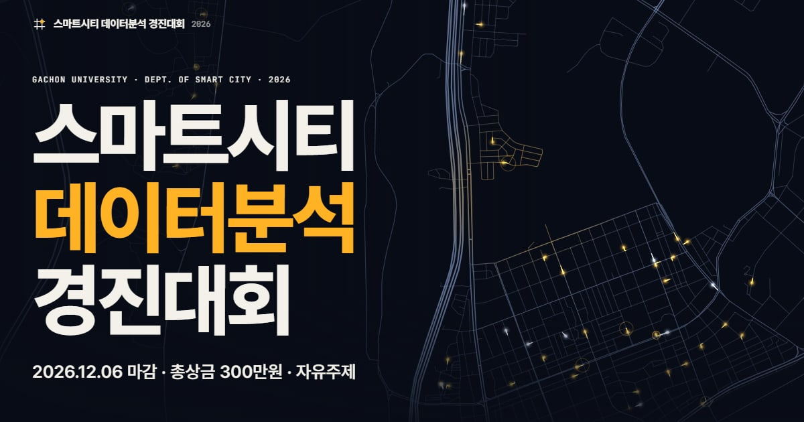

<div align="center">



# 스마트시티 데이터분석 경진대회 2026

가천대학교 스마트시티학과 경진대회 안내 페이지


**[사이트 보기 → camuslab.github.io/smartcity-data-challenge](https://camuslab.github.io/smartcity-data-challenge/)**

[문의](#문의) · [빠른 시작](#빠른-시작) · [내용 수정](#내용-수정) · [구조](#구조) · [배포](#배포)

</div>

## 소개

도시 문제를 데이터로 분석하는 학과 경진대회의 일정, 참가 방법, 심사, 시상을 한 페이지에 담은 정적 사이트입니다. 작년까지 쓰던 노션 페이지를 대신합니다.

| 항목       | 내용                                                                             |
| ---------- | -------------------------------------------------------------------------------- |
| 제출 마감  | 2026년 12월 6일 (일) 23:59, 이메일 제출                                          |
| 참가 대상  | 가천대학교 스마트시티학과 재학생 (복수전공·부전공 포함), 개인 또는 팀(최대 5명) |
| 제출물     | PPT 20장 이내, 웹페이지·동영상 함께 제출 가능                                   |
| 총상금     | 300만원 (대상 110만원, 최우수상 50만원 × 2, 우수상 30만원 × 3)                 |
| 본선·시상 | 2026년 12월 10일 (목) 컨버전스 데이, 가천대학교 AI공학관 100호                   |

## 문의

| 역할            | 이름   | 소속              | 연락처               |
| --------------- | ------ | ----------------- | -------------------- |
| 책임자 (관리자) | 여지호 | 가천대학교 부교수 | jihoyeo@gachon.ac.kr |

대회 문의는 책임자에게 보내 주세요. 사이트 오류나 수정 제안은 이 저장소의 Issues에 남겨 주세요.

## 특징

- **실제 도로망으로 그린 히어로.** OpenStreetMap에서 받은 7.2 km × 4.8 km 범위의 도로를 캔버스에 그리고, 그 위로 빛이 도로를 따라 달립니다. 가천대학교에서 시작해 서울 도심, 강남, 송도국제도시로 3초마다 지도가 바뀝니다. 포인터 가까이의 도로는 앰버색으로 밝아집니다.
- **스스로 갱신되는 일정.** D-day와 남은 시간이 1초마다 바뀌고, 일정표는 다음 일정을 표시합니다. 마감이 지나면 안내가 "접수 종료"로 바뀝니다. 모든 날짜 계산은 보는 사람의 시간대와 상관없이 한국 시각 기준입니다.
- **바로 쓰는 제출 메일 양식.** 받는 사람, 제목, 본문 양식이 채워진 메일 창을 열거나 본문 양식만 복사할 수 있습니다.
- **한 파일로 관리하는 내용.** 날짜, 상금, 평가 기준, FAQ가 `src/data/contest.ts` 하나에 있고 화면의 요일·합계·문장 속 숫자는 여기서 만들어집니다.
- **가벼운 구성.** 프레임워크 런타임 없이 스크립트 약 19 KB입니다. 도로망 데이터는 지역당 gzip 13~70 KB이고, 첫 지역만 먼저 받고 나머지는 뒤에서 받습니다.
- **접근성.** 키보드만으로 모든 기능을 쓸 수 있고, 화면낭독기용 날짜 읽기와 "움직임 줄이기" 설정을 지원합니다.

## 빠른 시작

Node 22.12 이상이 필요합니다.

```bash
git clone https://github.com/camuslab/smartcity-data-challenge.git
cd smartcity-data-challenge
npm install
npm run dev
```

브라우저에서 http://localhost:4321 을 엽니다.

| 명령                | 하는 일                               |
| ------------------- | ------------------------------------- |
| `npm run dev`     | 개발 서버 실행                        |
| `npm test`        | 단위 테스트 (날짜·상금·도로망 로직) |
| `npm run check`   | 타입 검사                             |
| `npm run build`   | `dist/`에 정적 파일 생성            |
| `npm run preview` | 빌드 결과 미리보기                    |
| `npm run roads`   | 도로망 데이터 다시 생성               |

## 내용 수정

대회 정보는 모두 `src/data/contest.ts`에 있습니다.

```ts
export const contest = {
  name: '스마트시티 데이터분석 경진대회',
  email: 'jihoyeo@gachon.ac.kr',
  deadline: '2026-12-06T23:59:59+09:00',
  maxTeamSize: 5,
  maxSlides: 20,
  // …
};
```

1. 이 파일에서 날짜, 상금, 문구를 고칩니다. 날짜는 한국 시각(`+09:00`)으로 적습니다.
2. `npm test`를 돌립니다. 상금 합계, 일정 순서, 요일이 맞는지 확인합니다. 금액이나 팀 수를 바꿨다면 `tests/contest.test.ts`의 기댓값도 함께 고칩니다.
3. `main` 브랜치에 push하면 자동으로 배포됩니다.

"대상과 최우수상을 가립니다"처럼 상 이름이 들어간 문장은 글로 적혀 있습니다. 상 구성을 바꿀 때는 같은 파일의 일정·FAQ 문장과 `src/components/Judging.astro`의 설명 문장을 함께 읽어 보세요.

공유 썸네일(`public/og.jpg`)에는 마감일과 총상금이 글자로 들어 있습니다. 대회명·마감일·상금이 바뀌면 히어로 화면을 1200 × 630으로 다시 캡처해 교체합니다. 원본은 `src/assets/og-source.png`입니다.

## 구조

```
src/
├── data/contest.ts        대회 정보 (여기만 고치면 됨)
├── data/hero-scenes.json  히어로 지도가 보여 주는 지역 목록
├── lib/                   날짜·금액 표기, 남은 시간 계산
├── components/            구역별 화면 (Hero, Glance, Topics, Entry, Judging, …)
├── scripts/
│   ├── roads/             히어로의 도로망 애니메이션 (그래프 · 화면 변환 · 이동 · 렌더러)
│   └── ui/                머리말, 카운트다운, 스크롤 등장, 복사 버튼
├── styles/                디자인 토큰과 공통 스타일
└── assets/                사진 원본
public/data/roads-*.json   지역별 도로망 데이터 (생성물)
scripts/build-roads.mjs    도로망 데이터 생성 스크립트
tests/                     단위 테스트
```

## 도로망 데이터

히어로와 마지막 구역의 지도는 `scripts/build-roads.mjs`가 만든 `public/data/roads-<지역>.json`을 그린 것입니다. 스크립트는 OpenStreetMap 도로를 받아 교차로를 노드로 하는 그래프로 바꾸고, 1 m 격자에 맞춰 단순화합니다.

| 지역                       | 파일                   | 도로 구간 |
| -------------------------- | ---------------------- | --------- |
| 가천대학교 (성남시 수정구) | `roads-gachon.json`  | 3,261     |
| 서울 도심 (중구)           | `roads-seoul.json`   | 7,521     |
| 강남 (강남구)              | `roads-gangnam.json` | 5,783     |
| 송도국제도시 (인천 연수구) | `roads-songdo.json`  | 1,385     |

```bash
npm run roads -- --refresh                # 모든 지역의 원본을 OpenStreetMap에서 받아 생성
npm run roads -- --area seoul --refresh   # 한 지역만
npm run roads                             # 받아 둔 원본으로 다시 생성 (같은 원본이면 결과가 같음)
```

지역을 추가하거나 바꾸려면 `src/data/hero-scenes.json`에 이름과 중심 좌표를 적고 `npm run roads -- --area <id> --refresh`를 돌립니다. 목록의 첫 지역이 처음에 보이는 지도이고, 마지막 구역의 지도에도 쓰입니다.

원본 응답은 `scripts/.cache/`에 저장되며 저장소에는 올라가지 않습니다. 그래서 저장소를 새로 받은 직후에는 `--refresh` 없이 실행하면 오류로 끝납니다. 생성된 `roads-*.json`은 저장소에 들어 있으므로 사이트를 빌드할 때 이 스크립트를 돌릴 필요는 없습니다.

## 배포

`main` 브랜치에 push하면 `.github/workflows/deploy.yml`이 테스트, 타입 검사, 빌드를 거쳐 GitHub Pages에 올립니다. 저장소 이름에 맞는 주소와 경로는 워크플로가 자동으로 넣습니다.

처음 한 번은 저장소의 Settings → Pages에서 Source를 **GitHub Actions**로 바꿔야 합니다.

## 기술

| 영역        | 사용한 것                                                                                                   |
| ----------- | ----------------------------------------------------------------------------------------------------------- |
| 사이트 생성 | [Astro 6](https://astro.build) (정적 출력)                                                                   |
| 언어        | TypeScript, CSS                                                                                             |
| 글꼴        | [Pretendard](https://github.com/orioncactus/pretendard), [JetBrains Mono](https://www.jetbrains.com/lp/mono/) |
| 그래픽      | Canvas 2D (외부 라이브러리 없음)                                                                            |
| 테스트      | [Vitest](https://vitest.dev)                                                                                 |
| 배포        | GitHub Actions, GitHub Pages                                                                                |

## 출처

- 지도 데이터 © [OpenStreetMap](https://www.openstreetmap.org/copyright) contributors, ODbL 라이선스.
- `src/assets/city-night.png`(컨버전스 데이 구역 배경)는 Higgsfield로 생성한 이미지입니다. 실제 장소를 찍은 사진이 아닙니다.
- 글꼴은 각각 SIL Open Font License를 따릅니다.
